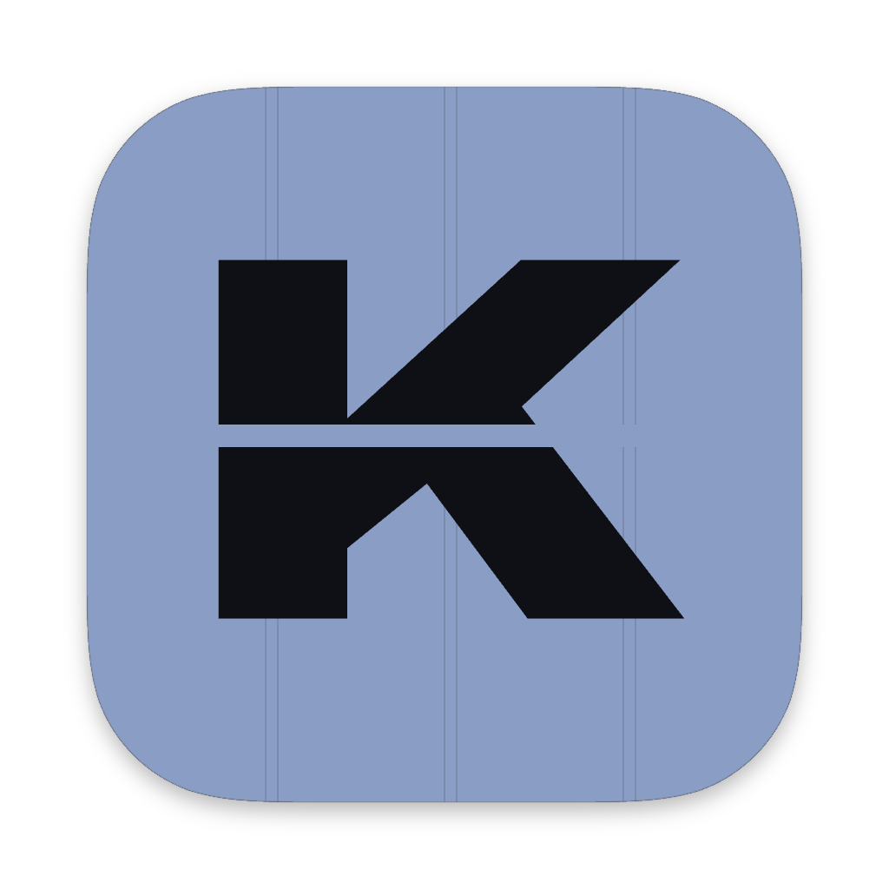
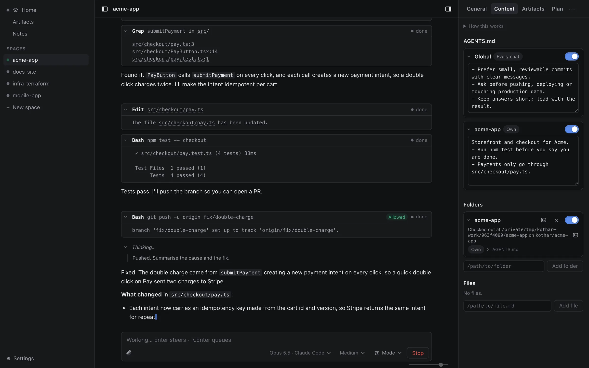

<p align="center">
  
</p>

<h1 align="center">Kothar</h1>

<p align="center"><strong>One desktop app for every coding agent.</strong><br>
Run Claude Code, Codex, OpenCode and pi side by side, with extensions you write once that work on all of them.</p>

<p align="center">
  <a href="https://github.com/billwang7599/kothar/releases/latest"></a>
  <a href="https://github.com/billwang7599/kothar/actions/workflows/ci.yml"></a>
  <a href="LICENSE.md"></a>
</p>

<p align="center">
  <a href="https://github.com/billwang7599/kothar/releases/latest"><strong>Download for macOS</strong></a> (Apple silicon, signed and notarized)
  · <a href="https://kothar.sh">kothar.sh</a>
  · <a href="https://kothar.sh/docs/">Docs</a>
</p>

<!-- SCREENSHOT: a space with a streaming reply, tool calls and the right panel goes here, e.g.
     <p align="center"></p>
     The website worker is producing screenshots; add one here once it lands. -->

## Why

Every coding agent has its own app, its own settings and its own plugins, and a plugin for one doesn't work in the
others. Kothar puts them in one window. You bring the engines you already use and pay for, and Kothar gives them the
same chats, memory, permissions, workers and extensions.

- **One place for all of them.** Switch a chat from Claude Code to pi without losing its history.
- **Agents in parallel.** A lead agent hands tasks to workers, each in its own git worktree, and you review their
  changes with Merge, Squash, Keep or Discard.
- **Extensions that work on every engine.** Notes, Artifacts, Deep Research, a browser in your own Chrome, MCP servers
  and more, all written against one public API.

If Kothar is useful to you, a ⭐ on GitHub helps more people find it.

## What it does

- **Engines:** Claude Code, Codex, OpenCode and pi, with saved accounts for each, plus any agent that speaks the
  [Agent Client Protocol](https://agentclientprotocol.com), added in Settings → Engines.
- **Spaces:** a folder becomes a space. Its lead agent streams replies, tool calls and permission requests. Chats
  survive a restart, and quitting or crashing loses no queued messages or workers.
- **Home:** the main chat, a personal assistant that sees every space and can make new ones.
- **Workers:** a lead runs tasks in parallel, each on its own branch and worktree. Their changes come back with their
  report for you to review.
- **Memory:** every chat remembers its whole conversation, as summaries an agent can zoom back into. Ask an agent to
  forget something and it removes it for good, after you confirm.
- **Permissions and sandboxing (macOS):** agents work in a sandboxed work folder. Switches decide what runs without
  asking, per space or everywhere, including trusted SSH hosts. Each attached folder can be edited in place, worked on
  as a copy, or kept read only.
- **Engine tools:** every built-in tool of Claude Code, pi and OpenCode has a switch in Settings.
- **Usage:** tokens and cost per turn, as each engine reports them, totalled in the chat header.
- **In the chat:** clickable file paths that open in your editor, inline images, and LaTeX math.
- **Setups and themes:** saved engine, model and instruction choices for a kind of job; Default and Glass themes, with
  more in the Marketplace.
- **Command line:** `kothar` drives a running Kothar from a terminal or script. See [Command line](#command-line).

The [docs on kothar.sh](https://kothar.sh/docs/) cover each of these in detail.

## Extensions

An extension is written once and works with every engine. It can add panels, commands and tools, react to chats and
turns, answer permission requests and rewrite messages, all through Kothar's public extension API.

Built in (in [`extensions/`](extensions/README.md)):

| Extension | What it does | On by default |
|---|---|---|
| Artifacts | Pages, small apps, diagrams and documents agents make, kept per space with every version | Yes |
| Inspector | Shows exactly what Kothar sent the engine each turn, and an Activity log | Yes |
| MCP servers | Connects GitHub, Linear, Notion and other MCP servers to every engine, with keys kept in Kothar | Yes |
| Memory | Summaries that let every chat remember its whole conversation | Yes |
| Notes | Obsidian-style Markdown notes in a popup (⌘⇧N), with `[[links]]`, tags and search | Yes |
| Plan | A Plan first mode: the agent only reads until you approve its plan | Yes |
| Processes | Dev servers and watchers that keep running between messages | Yes |
| Reconnect | Carries a turn on when the connection or the engine's service comes back | Yes |
| Skills | Agent Skills (`SKILL.md` folders) on every engine | Yes |
| Account rotation | Switches to your next saved account when one hits its usage limit | No |
| Browser | Lets agents browse in your own Chrome, with your logins, through the Kothar Chrome extension | No |
| Deep Research | Long, multi-source research that ends in a cited report | No |
| Git | A Changes tab with each checkout's branch, diffs and pull request | No |
| Pins | Pin messages and find them again in the Pinned tab | No |

Community extensions and themes install from the **Marketplace** (Settings → Community hub → Browse…). Each lists what
it uses through the API, Kothar shows that list before you install it, and every community extension stays off until
you turn it on.

**Write your own:** start from the template [kothar-sample-mod](https://github.com/billwang7599/kothar-sample-mod)
(or [kothar-themes](https://github.com/billwang7599/kothar-themes#make-your-own-theme) for a theme), try it with
**Install from folder…** in the Marketplace, then
[submit it to the catalog](https://github.com/billwang7599/kothar-marketplace#submit-a-theme-or-mod). The
[extension documentation](extension-documentation/index.md) covers building and publishing, with the full API
reference.

## Command line

`kothar` drives a running Kothar (the app or `npm run dev`) from a terminal or a script. It isn't in the DMG yet: run
it from a clone with `npm run kothar -- <command>`, or put it on your path with `npm link -w @kothar/cli`.

```sh
kothar list                          # spaces and their workers, with status (--json for scripts)
kothar new ~/code/app --name App     # make a space on a folder; prints its id
kothar send App "fix the failing test" --wait
                                     # stream the reply; exit when the turn ends
kothar status App                    # status, engine, model, queue, what it's waiting for
kothar read App --last 5             # the latest messages (--tools adds tool calls)
kothar stop App                      # stop the running turn
kothar approve App                   # approve the permission request it's waiting on (or deny)
```

A chat is named by its id, the start of one, or a space's name; Home is `home`. `send --wait` exits 0 when the turn
ends, 1 if it failed, 3 when it stops at a permission request or a question (the chat keeps waiting for `approve`,
`deny` or the app), and 4 after `--timeout`. `--approve` approves every request during the wait; leave it off unless
you'd have clicked Approve on all of them anyway. Ctrl+C leaves the turn running.

## Status

Kothar is in early development. [v0.1.0](https://github.com/billwang7599/kothar/releases/tag/v0.1.0) is the first
release: a signed and notarized DMG for Macs with Apple silicon. It also runs from source, in a browser tab or as the
desktop app; see [Running from source](CONTRIBUTING.md#running-from-source).

Not built yet: Intel Mac and Windows/Linux builds, sandboxing outside macOS, remote machines, and sync.

## Building the Mac app

`npm run package` builds `packages/desktop/release/Kothar-<version>-arm64.dmg` (Apple silicon). With a Developer ID
certificate in your keychain and a `kothar-notary` notarytool profile, it signs the app and the DMG, notarizes them
and staples the tickets. Without those, it's ad-hoc signed, which runs on the Mac that built it; elsewhere macOS blocks
it until it's opened with right-click → Open. The first line of the build says which. One-time setup, other ways to
give credentials and how to verify: [packages/desktop/README.md](packages/desktop/README.md).

To try a build beside your own Kothar, run it on a throwaway garage:
`KOTHAR_GARAGE=/tmp/k/garage KOTHAR_WORK=/tmp/k/work KOTHAR_USER_DATA=/tmp/k/data KOTHAR_PORT=4391 packages/desktop/release/mac-arm64/Kothar.app/Contents/MacOS/Kothar`.

## Contributing

Issues and pull requests are welcome. [CONTRIBUTING.md](CONTRIBUTING.md) covers running from source, the checks,
the repo layout, design rules and how to add an engine or an extension. The website and user docs live in
[website/](website/README.md).

## Licence

Kothar is source-available: you can read, run and change all of its code.

- **Kothar's core, app and built-in extensions:** [Functional Source License 1.1, Apache 2.0 future licence](LICENSE.md)
  (FSL-1.1-ALv2). You may use, copy, modify and redistribute it for any purpose except a competing commercial
  product or service. Two years after each version is released, that version becomes Apache 2.0.
- **The extension API (`packages/extension-api`):** [MIT](packages/extension-api/LICENSE), so extensions can use any
  licence they like.
